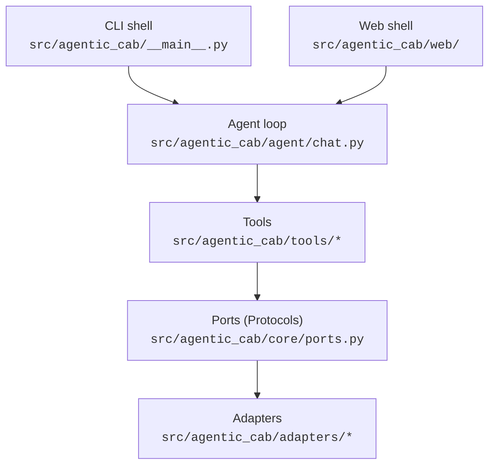

# Architecture

Agentic Cab Rides is a layered Python service: a thin CLI/web shell drives an
Anthropic-SDK-powered agent, which calls deterministic tool functions, which
talk to swappable adapters through narrow ports. Every layer depends only on
the layer below it; nothing reaches across. This document maps that structure,
the ports that separate the layers, and where each invariant in `CLAUDE.md`
is enforced.

For the full design rationale see
[`docs/superpowers/specs/2026-05-19-agentic-cab-rides-design.md`](superpowers/specs/2026-05-19-agentic-cab-rides-design.md).
For the 1-pager deliverable see [`docs/WRITEUP.md`](WRITEUP.md).

## Layer diagram

Arrows point only down. The agent never imports an adapter directly; it only
calls tools, and tools take ports (not concrete classes) as parameters.

## Ports

| Port | File | Responsibility | Implementations today |
|------|------|----------------|----------------------|
| `BookingProvider` | `core/ports.py` | Marketplace adapter: `discover` / `prepare` / `confirm` / `cancel`. Idempotency key required on every mutation. | `UberSimAdapter`, `MockAppointmentProvider` |
| `ConfirmationChannel` | `core/ports.py` | Owns the y/n decision for every state-mutating action. The agent cannot self-approve. | `CLIConfirmationChannel` (TTY), `WebConfirmationChannel` (SSE + POST), `ScriptedConfirmationChannel` (scenarios) |
| `ActionLog` | `core/ports.py` | Append-only JSONL emission, four rows per gated action. PII redacted at the boundary. | `JSONLActionLog` |
| `StateStore` | `core/ports.py` | SQLite-backed durable state: drafts, bookings, booking_events, idempotency_keys, pending_confirmations. | `SqliteStateStore` |
| `Clock` | `core/ports.py` | Now-source. Real time in interactive mode, frozen in scenario mode for determinism. | `SystemClock`, `FrozenClock` |
| `GeocoderPort` | `core/ports.py` | Address → `{formatted, lat, lng, confidence}`. Cached. | `InMemoryGeocoder`, `MapboxGeocoderAdapter` |

## Invariants and where they live

Each row maps a `CLAUDE.md` invariant to the layer that enforces it.
This is the audit map: if you want to verify the project still honours
an invariant, read the file in the "Enforced in" column.

| # | Invariant (abbrev.) | Enforced in |
|---|---------------------|-------------|
| 1 | Strict layer dependency direction | This document + code review; no import lint today |
| 2 | Structural confirmation gate | `tools/confirm.py`, `tools/cancel.py`, `core/ports.py::ConfirmationChannel`, `adapters/confirmation/*` |
| 3 | Fingerprint check before every gated provider call | `tools/confirm.py` (`prepare`→`confirm` pair), `core/fingerprint.py` |
| 4 | Re-quote before confirm; drift threshold | `tools/confirm.py` (post-fingerprint, pre-gate) |
| 5 | Idempotency keys required | `core/ports.py::BookingProvider`, `adapters/state_store.py::claim_or_recall`, schema UNIQUE constraint |
| 6 | Four-row action log per gated action | `tools/confirm.py`, `tools/cancel.py`, `adapters/action_log.py` |
| 7 | Persistence split (SQLite vs JSONL) | `adapters/state_store.py`, `adapters/action_log.py` |
| 8 | PII redaction at the log boundary | `adapters/action_log.py::redact` |
| 9 | Determinism in scenarios | `adapters/clock.py::FrozenClock`, `core/constants.py::MODEL_ID`, seeded RNGs |
| 10 | `Money(amount_cents, currency)`, never float | `core/types.py::Money` |
| 11 | ULIDs for all IDs | `core/ids.py` |
| 12 | No `--no-verify` | `.claude/settings.json` deny list, pre-push hook |
| 13 | No `TODO`/`FIXME`/`XXX` in code | Ruff `FIX` rule, pre-commit |
| 14 | No `print()` outside CLI/web/scripts | Ruff `T20` rule |

## Persistence split

Two durable surfaces, deliberately not merged:

- **SQLite (`data/state.db`)** holds anything that needs relational lookups
  or transactional guarantees: drafts, bookings, booking_events,
  idempotency_keys, pending_confirmations. The UNIQUE constraint on
  `idempotency_keys` is the load-bearing guarantee against double-bookings;
  keeping it in SQL means it survives crashes and is enforced by the
  database, not application code.
- **JSONL (`logs/<session_id>.jsonl`, `chat/`, geocode cache)** holds
  append-only audit artifacts. Flat files because the audit story depends
  on being trivially `grep`-able, `tail -f`-able, and replayable without
  a database. The action log is a deliverable surface — its format and
  flatness matter externally, not just internally.

Moving the action log into SQLite would lose this. The split is intentional
and described in `CLAUDE.md` invariant 7.

## See also

- [`docs/WRITEUP.md`](WRITEUP.md) — the 1-pager deliverable.
- [`docs/PHASES.md`](PHASES.md) — phase contract.
- [`docs/superpowers/specs/2026-05-19-agentic-cab-rides-design.md`](superpowers/specs/2026-05-19-agentic-cab-rides-design.md)
  — full design spec.
