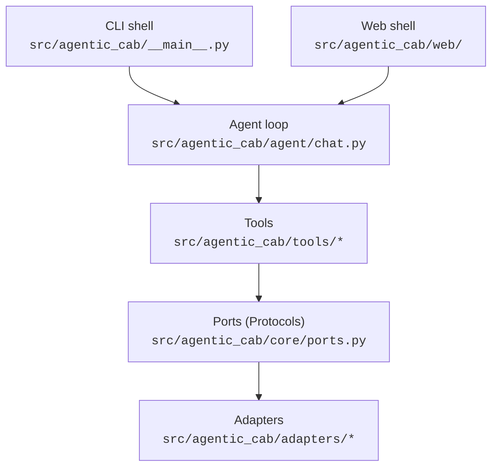

# Architecture

Agentic Cab Rides is a layered Python service: a thin CLI/web shell drives an
Anthropic-SDK-powered agent, which calls deterministic tool functions, which
talk to swappable adapters through narrow ports. Every layer depends only on
the layer below it; nothing reaches across. This document maps that structure,
the ports that separate the layers, and where each invariant in `CLAUDE.md`
is enforced.

This file owns the durable architecture story. Invariants live in
[`CLAUDE.md`](../CLAUDE.md); the phase contract lives in
[`docs/PHASES.md`](PHASES.md); the 1-pager deliverable is
[`docs/WRITEUP.md`](WRITEUP.md). Type and port definitions are authoritative
in code (`src/agentic_cab/core/types.py`, `src/agentic_cab/core/ports.py`).

## Layer diagram



Arrows point only down. The agent never imports an adapter directly; it only
calls tools, and tools take ports (not concrete classes) as parameters.

## Ports

| Port | File | Responsibility | Implementations today |
|------|------|----------------|----------------------|
| `BookingProvider` | `core/ports.py` | Marketplace adapter: `discover` / `prepare` / `confirm` / `cancel`. Idempotency key required on every mutation. | `UberSimAdapter`, `MockAppointmentProvider` |
| `ConfirmationChannel` | `core/ports.py` | Owns the y/n decision for every state-mutating action. The agent cannot self-approve. | `CLIConfirmationChannel` (TTY), `WebConfirmationChannel` (SSE + POST), `ScriptedConfirmationChannel` (scenarios) |
| `ActionLog` | `core/ports.py` | Append-only JSONL emission, four rows per gated action. PII redacted at the boundary. | `JSONLActionLog` |
| `StateStore` | `core/ports.py` | SQLite-backed durable state: drafts, bookings, booking_events, idempotency_keys, pending_confirmations. | `SqliteStateStore` |
| `Clock` | `core/ports.py` | Now-source. Real time in interactive mode, frozen in scenario mode for determinism. | `SystemClock`, `FrozenClock` |
| `GeocoderPort` | `core/ports.py` | Address → `{formatted, lat, lng, confidence}`. Cached. | `InMemoryGeocoder`, `MapboxGeocoderAdapter` |

## Invariants and where they live

Each row maps a `CLAUDE.md` invariant to the layer that enforces it.
This is the audit map: if you want to verify the project still honours
an invariant, read the file in the "Enforced in" column.

| # | Invariant (abbrev.) | Enforced in |
|---|---------------------|-------------|
| 1 | Strict layer dependency direction | This document + code review; no import lint today |
| 2 | Structural confirmation gate | `tools/confirm.py`, `tools/cancel.py`, `core/ports.py::ConfirmationChannel`, `adapters/confirmation/*` |
| 3 | Fingerprint check before every gated provider call | `tools/confirm.py` (`prepare`→`confirm` pair), `core/fingerprint.py` |
| 4 | Re-quote before confirm; drift threshold | `tools/confirm.py` (post-fingerprint, pre-gate) |
| 5 | Idempotency keys required | `core/ports.py::BookingProvider`, `adapters/state_store.py::claim_or_recall`, schema UNIQUE constraint |
| 6 | Four-row action log per gated action | `tools/confirm.py`, `tools/cancel.py`, `adapters/action_log.py` |
| 7 | Persistence split (SQLite vs JSONL) | `adapters/state_store.py`, `adapters/action_log.py` |
| 8 | PII redaction at the log boundary | `adapters/action_log.py::redact` |
| 9 | Determinism in scenarios | `adapters/clock.py::FrozenClock`, `core/constants.py::MODEL_ID`, seeded RNGs |
| 10 | `Money(amount_cents, currency)`, never float | `core/types.py::Money` |
| 11 | ULIDs for all IDs | `core/ids.py` |
| 12 | No `--no-verify` | `.claude/settings.json` deny list, pre-push hook |
| 13 | No `TODO`/`FIXME`/`XXX` in code | Ruff `FIX` rule, pre-commit |
| 14 | No `print()` outside CLI/web/scripts | Ruff `T20` rule |

## Type contracts (overview)

Authoritative definitions live in `src/agentic_cab/core/types.py`. The shapes
that the architecture leans on:

- **`Intent`** is a tagged union (today: `RideIntent`; the Zocdoc swap adds
  `AppointmentIntent`). `BookingProvider.supported_intent_kinds` routes intents
  to capable adapters.
- **`Option.details`** is a discriminated union (`kind` discriminator) so the
  agent prompt stays typed across intent variants.
- **`Draft`** carries `option_snapshot: Option` (frozen at prepare-time) and
  `fingerprint: str` (`sha256(canonical_json(option_snapshot))`). The
  fingerprint is the structural guard against mutation between prepare and
  confirm.
- **`Booking`** carries `summary: Option`, `events: list[BookingEvent]`, and
  an optional `cancellation: CancellationInfo`. The booking's `intent_hash`
  is not a field on the `Booking` model — it is persisted in SQLite against
  the booking row (written via `store.set_booking_intent_hash`) so the
  cross-session dedup path can look up active bookings by intent without
  touching the model surface.
- **`Money(amount_cents: int, currency: str)`** — never floats (invariant 10).

## Core flow: `confirm_booking`

The gated tool is where most invariants compose. The algorithm
(`src/agentic_cab/tools/confirm.py`):

1. **Load draft.** Reject if unknown, expired, or already consumed
   (`consumed_at IS NOT NULL`). Drafts are single-use even though the
   idempotency key is the durable double-booking barrier.
2. **Recompute fingerprint** over `draft.option_snapshot`. Reject on mismatch
   (invariant 3).
3. **Re-quote** via `provider.discover()`. If price drift exceeds
   `RE_QUOTE_DRIFT_THRESHOLD_CENTS`, re-prepare and return
   `PriceChanged{new_draft_id, new_summary}` — the gate is never invoked at a
   stale price (invariant 4).
4. **Intent dedup.** Compute `intent_hash` over the user's stable intent
   (pickup, dropoff, 10-minute-bucketed `when`, party size, vehicle class). If
   an active booking exists for the same intent and no `intent_override_nonce`
   was supplied, short-circuit with `duplicate_intent` and surface the existing
   booking to the agent. No `executed` row follows (invariant 6).
5. **Derive idempotency key.** `confirm_idempotency_key = sha256(canonical_json(
   {intent_hash, generation, nonce, op:"confirm"}))`, where `generation` counts
   prior terminal bookings for this intent (lets the user legitimately re-book
   after a previous trip finishes). The key is invariant across `draft_id`
   regeneration and across process restarts — closing cross-session dedup
   (scenario `06_cross_session_dedup`).
6. **`store.claim_or_recall(key, "confirm")`.** If recalled, short-circuit
   with a `replayed=true` executed row and return the recalled booking — the
   original channel approval is canonical for this key (no re-prompt).
7. **`await channel.request(ConfirmationRequest(...))`.** If approved →
   `provider.confirm(draft_id, idempotency_key)`; persist the Booking and
   `store.finalize_idempotency(key, booking)`. A user-decline calls
   `release_claim` so a retry with identical intent re-derives the same key
   but finds it fresh — declines do not become poison pills.

`cancel_booking` is one tool, two-phase under the hood: quote fee → gate on
fee → execute. Cancel keys are bound to `(booking_id, fee_cents, status_at_quote)`.

## Action log row shapes

Per-session JSONL at `logs/<session_id>.jsonl`. Every gated action emits four
rows linked by `action_id`; read-only tools emit `requested` + `outcome` only.

```json
// requested
{"ts":"...","session_id":"...","turn_id":"...","action_id":"...",
 "kind":"requested","tool":"confirm_booking","args":{...},"actor":"agent"}

// verified
{"ts":"...","action_id":"...","tool":"confirm_booking","kind":"verified",
 "checks":{"draft_found":true,"fingerprint_match":true,
           "requote_price_drift_cents":0,
           "confirmation":{"approved":true,"approver":"cli-tty","approved_at":"..."}},
 "result":"ok"}      // or "rejected" with "reason"

// executed
{"ts":"...","action_id":"...","tool":"confirm_booking","kind":"executed",
 "provider":"uber-sim","method":"confirm","idempotency_key":"...",
 "request":{...},"latency_ms":143}

// outcome
{"ts":"...","action_id":"...","tool":"confirm_booking","kind":"outcome",
 "status":"confirmed","result":{"booking_id":"..."},"error":null}
```

`verified.result == "rejected"` short-circuits — no `executed` row follows
(invariant 6). PII redaction (raw address text, phone, names) happens at the
log boundary in `adapters/action_log.py::redact` (invariant 8).

Outcome statuses emitted today (`outcome.status` in `confirm_booking` /
`cancel_booking`): `confirmed` (happy path), `rejected` (gate decline,
fingerprint mismatch, draft expiry, etc.), `price_changed`, `in_progress`
(claim exists but was never finalised — process crash or concurrent retry),
`duplicate_intent`. `verified.result` uses a different vocabulary —
`"ok"` / `"rejected"`; the two layers are intentionally distinct (verified
records gate verdict, outcome records the tool's terminal state).

## Persistence split

Two durable surfaces, deliberately not merged:

- **SQLite (`data/state.db`)** holds anything that needs relational lookups
  or transactional guarantees: drafts, bookings, booking_events,
  idempotency_keys, pending_confirmations. The UNIQUE constraint on
  `idempotency_keys` is the load-bearing guarantee against double-bookings;
  keeping it in SQL means it survives crashes and is enforced by the
  database, not application code.
- **JSONL (`logs/<session_id>.jsonl`, `chat/`, geocode cache)** holds
  append-only audit artifacts. Flat files because the audit story depends
  on being trivially `grep`-able, `tail -f`-able, and replayable without
  a database. The action log is a deliverable surface — its format and
  flatness matter externally, not just internally.

Moving the action log into SQLite would lose this. The split is intentional
and described in `CLAUDE.md` invariant 7.

## See also

- [`docs/WRITEUP.md`](WRITEUP.md) — the 1-pager deliverable.
- [`docs/PHASES.md`](PHASES.md) — phase contract.
- [`CLAUDE.md`](../CLAUDE.md) — invariants every session must respect.
