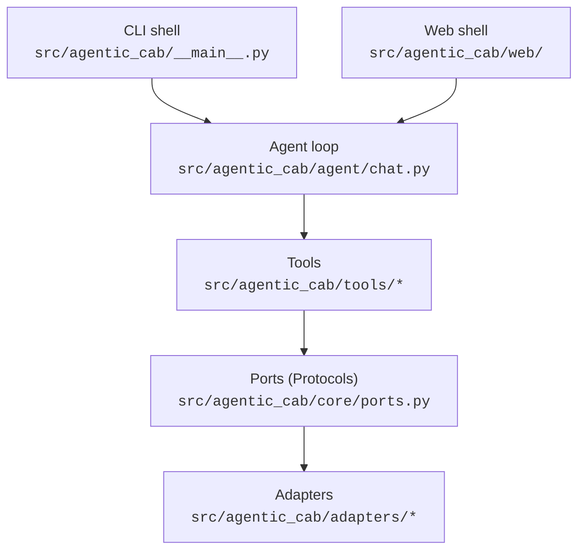

# Architecture

Agentic Cab Rides is a layered Python service: a thin CLI/web shell drives an
Anthropic-SDK-powered agent, which calls deterministic tool functions, which
talk to swappable adapters through narrow ports. Every layer depends only on
the layer below it; nothing reaches across. This document maps that structure,
the ports that separate the layers, and where each invariant in `CLAUDE.md`
is enforced.

This file owns the durable architecture story. Invariants live in
[`CLAUDE.md`](../CLAUDE.md); the phase contract lives in
[`docs/PHASES.md`](PHASES.md); the production-readiness writeup is
[`docs/WRITEUP.md`](WRITEUP.md). Type and port definitions are authoritative
in code (`src/agentic_cab/core/types.py`, `src/agentic_cab/core/ports.py`).

## Layer diagram



Arrows point only down. The agent never imports an adapter directly; it only
calls tools, and tools take ports (not concrete classes) as parameters.

## Runtime topology

The layer diagram above describes code dependencies. This section describes
how the same layers are assembled into running processes today. The project
ships two first-class surfaces (REPL and web) and one batch surface
(scenarios); production deployment is out of scope and discussed in
[`docs/WRITEUP.md`](WRITEUP.md).

| Surface | Entry point | Process model | Confirmation channel | Per-session state |
|---------|-------------|---------------|----------------------|-------------------|
| **REPL** | `make repl` → `python -m agentic_cab repl` | One long-lived Python process. Stdin loop reads chat input; agent calls tools in-process. | `CLIConfirmationChannel` reads bare y/n from `/dev/tty` — a separate file handle from stdin, so chat text cannot inject approvals. | Adapter instance lives for the whole process; provider in-memory caches (`_option_cache`, `_intent_cache`) survive across turns naturally. |
| **Web** | `make web` → `uvicorn agentic_cab.web.app:create_app --factory` | Single uvicorn worker, FastAPI app. One browser tab = one server-minted `session_id` (`POST /sessions`). SSE stream pushes assistant tokens and gate prompts; `POST /sessions/{session_id}/confirmations/{subject_id}` delivers the y/n. Requests with a non-loopback `Host` get 400 (`TrustedHostMiddleware`); state-changing requests with a foreign `Origin` get 403 (`SameOriginMiddleware`). See "Web session authentication" below. | `WebConfirmationChannel` blocks the tool call on an `asyncio.Future` resolved by the POST handler — only the caller's own session channel is reachable. | `UberSimAdapter` is memoized per `session_id` (PR #8) so option/intent caches survive within a session. They do not survive worker restart — see WRITEUP §2 "Provider option durability". |
| **Scenarios** | `make transcripts` (or `pytest -m scenario`) | Per-scenario in-process run with a `FrozenClock` and a `ScriptedConfirmationChannel`. Each scenario is a fresh state DB and adapter under a `tmp_path`. | `ScriptedConfirmationChannel` reads decisions from the scenario YAML. | Isolated per run; not shared with REPL/web. |

Shared by all three surfaces:

- **State** — SQLite (`<data dir>/state.db` for interactive surfaces — `data/` unless `AGENTIC_CAB_DATA_DIR` is set — and a per-scenario DB). WAL journaling; same schema (`adapters/schema.sql`) regardless of surface.
- **Action log + chat history** — per-session JSONL under `logs/` (`<session_id>.jsonl`, `<session_id>.chat.jsonl`). REPL and web write to the same directory. `session_id` is validated as a canonical ULID at every input boundary (web request models, `scripts/replay.py`, `make replay`), and path builders in `core/paths.py` resolve the final path and refuse anything outside the log dir.
- **Geocode cache** — read-only committed fixtures + writable cache under the data dir. Both layers hold one JSON per `sha1(query.strip().lower())`. Lookups try the writable cache (`<data dir>/geocode/`, or `AGENTIC_CAB_GEOCODE_CACHE_DIR`; gitignored, because entries keep the raw query) and then the committed `fixtures/geocode/`, which nothing writes at runtime. Scenario runs read the same fixtures, so transcripts stay reproducible.
- **Runtime settings** — `core/settings.py::RuntimeSettings.from_env` resolves the data, log, chat and geocode-cache dirs and the web port from `AGENTIC_CAB_*` (see `.env.example`). Only composition roots (`__main__.py`, `create_app`, `run_repl`, `scripts/replay.py`) call it. Instances with disjoint values run side by side; the action log stays under the log dir and chat history under the chat dir (default: the log dir).
- **Secrets** — `.env` symlinked from `~/.config/agentic-cab-rides/.env`; loaded at process start.

### Web session authentication

`POST /sessions` mints three server-side values: the `session_id` (ULID,
returned in the body), a **token** (`secrets.token_urlsafe(32)`, 256 bits),
and a **principal** (`principal_id`, a ULID). The token is set only as an
`HttpOnly; SameSite=Strict; Path=/` cookie named
`cab_session_<port>_<session_id>` — one per session so tabs never clobber each
other — with `Max-Age` of 8 hours. The `<port>` is `AGENTIC_CAB_WEB_PORT`
(the port served): browsers do not separate cookies by port, so two instances
on one host see each other's cookies, and the port keeps each instance to its
own. The cookie is set once and does not slide,
so it is deliberately longer than the 1-hour idle TTL (which does slide) rather
than equal to it. Each `POST /sessions` also expires any `cab_session_<port>_*`
cookie (this instance's only) the request carries whose session is no longer
held server-side, so page reloads cannot pile up dead cookies until the
`Cookie` header overflows.
The token is never returned in a body, logged, or put in a URL (a cookie
rather than a header because `EventSource` cannot set headers, and a query
string would leak into access logs). `SameSite=Strict` blocks cross-site POSTs
to the confirmation route. `Secure` is not set because `make web` serves plain
http on localhost.

`SameSite=Strict` is not enough on its own: `localhost:3000` and
`localhost:8000` are the *same site*, so a page served from another port still
gets the cookie attached, and a DNS-rebinding page reaches the server under a
hostname it controls. Two middlewares in front of every route close both gaps:

- **Host allowlist.** `TrustedHostMiddleware` (`www_redirect=False`) accepts
  only `Host` values `127.0.0.1`, `localhost`, and the configured bind host;
  anything else gets 400. The bind host is the `bind_host` argument to
  `create_app` (`python -m agentic_cab web --host X` passes it), else the
  `AGENTIC_CAB_WEB_HOST` environment variable, which `make web` / `make demo`
  set from `WEB_HOST` because `uvicorn --factory` cannot pass arguments.
  All-interfaces bind addresses add nothing, and `"*"` raises `ValueError`, so
  configuration can never switch the check off.
- **Same-origin check.** `SameOriginMiddleware` (`web/origin.py`, plain ASGI so
  the `/events` SSE stream is untouched) refuses with 403 any `POST`, `PUT`,
  `PATCH` or `DELETE` whose `Origin` header is present and is not the server's
  own origin, defined as `f"{scheme}://{Host}"` compared case-insensitively.
  `Origin: null`, another port and another scheme are all refused; a request
  with no `Origin` passes (non-browser clients send none; browsers always send
  it on POST). A refusal is logged as `web.origin.rejected` with method and
  path only. It covers `POST /sessions`, `POST /chat` and the confirmation
  route, and any state-changing route added later.

Order: the Host check is outermost and runs first, so a request with both a
foreign `Host` and a foreign `Origin` gets 400. The Origin check depends on
that order — once `Host` is confined to the allowlist, an `Origin` equal to it
is on an allowed host with the port and scheme the browser actually used. A
refused confirmation POST never reaches `WebConfirmationChannel.resolve`.

Every session route requires the cookie, checked with `hmac.compare_digest`:
`POST /chat`, `GET /events`, `POST /sessions/{id}/confirmations/{subject_id}`,
and `GET /sessions/{id}/log`. Unknown, evicted, cookie-less, or mismatched
sessions all get the same 403; an authorized caller naming a `subject_id` not
pending in its own session gets 404. Sessions are created only by
`POST /sessions` — an evicted id is never revived.

Token vs principal: the token is a credential (proves "this browser owns this
session") and lives only in process memory and the cookie. The principal is
an identifier (who approved) and is recorded as `approver_id` on the
`verified` row. The confirmation body carries only `approved`; the approver is
set inside `WebConfirmationChannel`, whose `resolve()` has no approver
parameter at all.

Not deployed today: no container, no orchestrator, no horizontal scale. The web surface assumes a single worker (in-memory adapter memoization is per-process; SSE expects sticky sessions). Production direction — a worker pool with shared-store option durability, secrets-manager-backed credentials, and a polling `track_booking` loop — is sketched in [`docs/WRITEUP.md`](WRITEUP.md) §2 and the priority list in §3.

## Ports

| Port | File | Responsibility | Implementations today |
|------|------|----------------|----------------------|
| `BookingProvider` | `core/ports.py` | Marketplace adapter: `discover` / `prepare` / `confirm` / `cancel`. Idempotency key required on every mutation. | `UberSimAdapter`, `MockAppointmentProvider` |
| `ConfirmationChannel` | `core/ports.py` | Owns the y/n decision for every state-mutating action. The agent cannot self-approve. | `CLIConfirmationChannel` (TTY), `WebConfirmationChannel` (SSE + POST), `ScriptedConfirmationChannel` (scenarios) |
| `ActionLog` | `core/ports.py` | Append-only JSONL emission, four rows per gated action. PII redacted at the boundary. | `JSONLActionLog` |
| `StateStore` | `core/ports.py` | SQLite-backed durable state: drafts, bookings, booking_events, idempotency_keys, pending_confirmations. | `SqliteStateStore` |
| `Clock` | `core/ports.py` | Now-source plus a monotonic counter (`monotonic_ns`) for call-latency timing. Real time in interactive mode, frozen/deterministic in scenario mode. | `SystemClock`, `FrozenClock` |
| `GeocoderPort` | `core/ports.py` | Address → `{formatted, lat, lng, confidence}`. Cached. | `InMemoryGeocoder`, `MapboxGeocoderAdapter` |

## Invariants and where they live

Each row maps a `CLAUDE.md` invariant to the layer that enforces it.
This is the audit map: if you want to verify the project still honours
an invariant, read the file in the "Enforced in" column.

| # | Invariant (abbrev.) | Enforced in |
|---|---------------------|-------------|
| 1 | Strict layer dependency direction | This document + code review; no import lint today |
| 2 | Structural confirmation gate | `tools/confirm.py`, `tools/cancel.py`, `core/ports.py::ConfirmationChannel`, `adapters/confirmation/*` |
| 3 | Fingerprint check before every gated provider call | `tools/confirm.py` (`prepare`→`confirm` pair), `core/fingerprint.py` |
| 4 | Re-quote before confirm; drift threshold | `tools/confirm.py` (post-fingerprint, pre-gate) |
| 5 | Idempotency keys required | `core/ports.py::BookingProvider`, `adapters/state_store.py::claim_or_recall`, schema UNIQUE constraint |
| 6 | Four-row action log per gated action | `tools/confirm.py`, `tools/cancel.py`, `adapters/action_log.py` |
| 7 | Persistence split (SQLite vs JSONL) | `adapters/state_store.py`, `adapters/action_log.py` |
| 8 | PII redaction at the log boundary | `adapters/action_log.py::redact` |
| 9 | Determinism in scenarios | `adapters/clock.py::FrozenClock`, `core/constants.py::MODEL_ID`, seeded RNGs |
| 10 | `Money(amount_cents, currency)`, never float | `core/types.py::Money` |
| 11 | ULIDs for all IDs | `core/ids.py` (generation and `SessionId` boundary validation), `core/paths.py` (path containment) |
| 12 | No `--no-verify` | `.claude/settings.json` deny list, pre-push hook |
| 13 | No `TODO`/`FIXME`/`XXX` in code | Ruff `FIX` rule, pre-commit |
| 14 | No `print()` outside CLI/web/scripts | Ruff `T20` rule |

## Type contracts (overview)

Authoritative definitions live in `src/agentic_cab/core/types.py`. The shapes
that the architecture leans on:

- **`Intent`** is a tagged union (today: `RideIntent`; the Zocdoc swap adds
  `AppointmentIntent`). `BookingProvider.supported_intent_kinds` routes intents
  to capable adapters.
- **`Option.details`** is a discriminated union (`kind` discriminator) so the
  agent prompt stays typed across intent variants.
- **`Draft`** carries `option_snapshot: Option` (frozen at prepare-time) and
  `fingerprint: str` (`sha256(canonical_json(option_snapshot))`). The
  fingerprint is the structural guard against mutation between prepare and
  confirm.
- **`Booking`** carries `summary: Option`, `events: list[BookingEvent]`, and
  an optional `cancellation: CancellationInfo`. The booking's `intent_hash`
  is not a field on the `Booking` model — it is persisted in SQLite against
  the booking row (written via `store.set_booking_intent_hash`) so the
  cross-session dedup path can look up active bookings by intent without
  touching the model surface.
- **`Money(amount_cents: int, currency: str)`** — never floats (invariant 10).

## Core flow: `confirm_booking`

The gated tool is where most invariants compose. The algorithm
(`src/agentic_cab/tools/confirm.py`):

1. **Load draft.** Reject if unknown, expired, or already consumed
   (`consumed_at IS NOT NULL`). Drafts are single-use even though the
   idempotency key is the durable double-booking barrier.
2. **Recompute fingerprint** over `draft.option_snapshot`. Reject on mismatch
   (invariant 3).
3. **Re-quote** via `provider.discover()`. If price drift exceeds
   `RE_QUOTE_DRIFT_THRESHOLD_CENTS`, re-prepare and return
   `PriceChanged{new_draft_id, new_summary}` — the gate is never invoked at a
   stale price (invariant 4).
4. **Intent dedup.** Compute `intent_hash` over the user's stable intent
   (pickup, dropoff, 10-minute-bucketed `when`, party size, vehicle class). If
   an active booking exists for the same intent and no `intent_override_nonce`
   was supplied, short-circuit with `duplicate_intent` and surface the existing
   booking to the agent. No `executed` row follows (invariant 6).
5. **Derive idempotency key.** `confirm_idempotency_key = sha256(canonical_json(
   {intent_hash, generation, nonce, op:"confirm"}))`, where `generation` counts
   prior terminal bookings for this intent (lets the user legitimately re-book
   after a previous trip finishes). The key is invariant across `draft_id`
   regeneration and across process restarts — closing cross-session dedup
   (scenario `06_cross_session_dedup`).
6. **`store.claim_or_recall(key, "confirm")`.** If recalled, short-circuit
   with a `replayed=true` executed row and return the recalled booking — the
   original channel approval is canonical for this key (no re-prompt).
7. **`await channel.request(ConfirmationRequest(...))`.** If approved →
   `provider.confirm(draft_id, idempotency_key)`; persist the Booking and
   `store.finalize_idempotency(key, booking)`. A user-decline calls
   `release_claim` so a retry with identical intent re-derives the same key
   but finds it fresh — declines do not become poison pills.

`cancel_booking` is one tool, two-phase under the hood: quote fee → gate on
fee → execute. Cancel keys are bound to `(booking_id, fee_cents, status_at_quote)`.

## Action log row shapes

Per-session JSONL at `logs/<session_id>.jsonl`. Every gated action emits four
rows linked by `action_id`; read-only tools emit `requested` + `outcome` only.

`verified.checks.confirmation` is the channel's `ConfirmationResult` verbatim.
`channel` is one of `cli` / `web` / `scripted`; `approver_id` is a
server-issued principal (a per-REPL ULID for the CLI, the session's
`principal_id` for the web, the constant `"scripted"` for scenarios) and is
`null` on decline or timeout. Neither is ever taken from client input or OS
identity.

```json
// requested
{"ts":"...","session_id":"...","turn_id":"...","action_id":"...",
 "kind":"requested","tool":"confirm_booking","args":{...},"actor":"agent"}

// verified
{"ts":"...","action_id":"...","tool":"confirm_booking","kind":"verified",
 "checks":{"draft_found":true,"fingerprint_match":true,
           "requote_price_drift_cents":0,
           "confirmation":{"approved":true,"reason":"approved","approver":"cli-tty",
                           "approved_at":"...","approver_id":"<principal ULID>",
                           "channel":"cli"}},
 "result":"ok"}      // or "rejected" with "reason"

// executed
{"ts":"...","action_id":"...","tool":"confirm_booking","kind":"executed",
 "provider":"uber-sim","method":"confirm","idempotency_key":"...",
 "request":{...},"latency_ms":0}

// outcome
{"ts":"...","action_id":"...","tool":"confirm_booking","kind":"outcome",
 "status":"confirmed","result":{"booking_id":"..."},"error":null}
```

`verified.result == "rejected"` short-circuits — no `executed` row follows
(invariant 6). PII redaction (raw address text, phone, names) happens at the
log boundary in `adapters/action_log.py::redact` (invariant 8).

Cost fields on gated `outcome` rows (`llm_calls_since_last_action`,
`cost_microcents_since_last_action`, P8) do **not** report the cost of the
action they're attached to. The `CostMeter` is one per session, and the only
drain point is inside the gated tool's `_emit_outcome`. So the value emitted is
the cost of every Anthropic call recorded on this session's meter since the
previous drain — not "this action's cost" and not "this turn's cost". It is
wrong in two directions: it **over-counts** by including every conversational
turn since the last gated action (discovery chit-chat, re-quotes, clarifying
questions), and it **under-counts** by excluding the current turn's wrap-up
call — the model call made after the tool returns, which is structurally
unattributable because it happens after `_emit_outcome` has already drained
the meter. A reader must not treat this number as the booking's cost; treat it
as a rolling session-cost checkpoint that resets on every gated action.

These fields carry token counts and integer microcents only —
`LLMCall.latency_ms` is kept in memory on the meter and deliberately never
emitted. The honest reason is not reproducibility (emitted token counts and
cost are themselves per-run-variable, per invariant 9) — it's that wall-clock
latency is pure machine noise carrying no auditable signal, whereas token
counts and cost are the artifact under audit even though they vary run to run.

Outcome statuses emitted today (`outcome.status` in `confirm_booking` /
`cancel_booking`): `confirmed` (happy path), `rejected` (gate decline,
fingerprint mismatch, draft expiry, etc.), `price_changed`, `in_progress`
(claim exists but was never finalised — process crash or concurrent retry),
`duplicate_intent`. `verified.result` uses a different vocabulary —
`"ok"` / `"rejected"`; the two layers are intentionally distinct (verified
records gate verdict, outcome records the tool's terminal state).

## Persistence split

Two durable surfaces, deliberately not merged:

- **SQLite (`<data dir>/state.db`)** holds anything that needs relational lookups
  or transactional guarantees: drafts, bookings, booking_events,
  idempotency_keys, pending_confirmations. The UNIQUE constraint on
  `idempotency_keys` is the load-bearing guarantee against double-bookings;
  keeping it in SQL means it survives crashes and is enforced by the
  database, not application code.
- **JSONL (`<log dir>/<session_id>.jsonl`, `<chat dir>/<session_id>.chat.jsonl`,
  geocode cache)** holds append-only audit artifacts. The geocode cache is
  read-only committed fixtures + writable cache under the data dir. Flat files because the audit story depends
  on being trivially `grep`-able, `tail -f`-able, and replayable without
  a database. The action log is an externally consumable surface — its
  format and flatness matter externally, not just internally.

Moving the action log into SQLite would lose this. The split is intentional
and described in `CLAUDE.md` invariant 7.

## See also

- [`docs/WRITEUP.md`](WRITEUP.md) — the production-readiness writeup.
- [`docs/PHASES.md`](PHASES.md) — phase contract.
- [`CLAUDE.md`](../CLAUDE.md) — invariants every session must respect.
