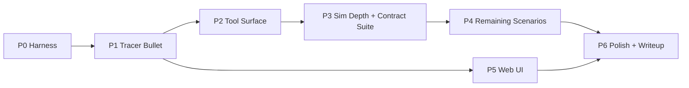

# Phases & Definition of Done

This is a **static contract**, not a status tracker. It defines what "done" means and what each phase has to deliver. Status lives in `git log` and `make verify` — not in this file.

Read this once to understand the shape of the work. Refer back when claiming a slice or phase is done.

**Source spec:** `docs/superpowers/specs/2026-05-19-agentic-cab-rides-design.md`
**Invariants:** `CLAUDE.md` §"Invariants — never violate without an explicit spec update"

---

## Definition of Done (every slice)

A slice is **done** only when *all* of these hold:

- [ ] `make verify` passes locally (fmt-check + lint + typecheck + test-fast)
- [ ] Pre-commit + pre-push hooks ran clean — never `--no-verify`
- [ ] Provider contract test suite passes for every registered adapter
- [ ] At least one scenario the slice touches re-renders with invariants passing (`make transcripts-ci` for the affected scenario)
- [ ] Commit is Conventional and **scoped to phase**: `feat(P1):`, `fix(P3):`, `refactor(P2):`, `test(P3):`. Pure docs/chore commits may omit the phase scope.
- [ ] One concern per commit. No bundling refactors with features.
- [ ] Net-new follow-ups extracted to `docs/FOLLOWUPS.md` — never inline `TODO`
- [ ] Non-trivial slices: Ralph-loop review captured (dispositions in commit body, raw review in `docs/scratch/.review-*.md` if verbose)
- [ ] All 14 invariants in `CLAUDE.md` still hold
- [ ] **Pushed to `origin/main` and CI is green.** A slice is *not* shipped until `git push` lands and the GitHub Actions run on the merge commit is green. Local commits do not count. Verify with `gh run list --limit 1 --branch main` after pushing.

A **phase** is done when every slice's DOD is met *and* the phase's acceptance bullets below are all satisfied.

---

## Tracking signal

No tracker file. To see status:

```bash
make status                                 # branch, dirty, recent commits, per-phase counts
git log origin/main --oneline | grep '(P3)' # P3 slices SHIPPED (pushed to remote)
git log origin/main --grep='(P[0-9])'       # full shipped phase history
git log @{u}..HEAD --oneline                # locally committed but not yet pushed (= not shipped)
make verify && make transcripts-ci          # local gate status
gh run list --limit 5 --branch main         # remote CI status
```

**"Shipped" means `origin/main`, not local `HEAD`.** A green local gate is necessary but not sufficient. The slice is not done until pushed and CI green on the remote.

---

## Phase dependency graph



P5 (web UI) branches from P1 — the agent loop, tool surface, and one working scenario are sufficient to start. P5 and P3/P4 can be developed in parallel via `superpowers:subagent-driven-development` if budget allows.

---

## P0 — Harness  *(shipped)*

**Goal:** rigor enforced before code exists.

**Acceptance:**
- [x] `pyproject.toml` with uv, ruff, pyright, pytest configured
- [x] `Makefile` is the single discovery surface; `make help` works
- [x] Pre-commit + pre-push hooks installed (`.pre-commit-config.yaml`)
- [x] `.claude/settings.json` with permission allowlist + deny on `--no-verify` + SessionStart hook
- [x] `.claude/skills/slice-delivery/SKILL.md` written
- [x] `CLAUDE.md` with 14 invariants
- [x] `docs/PHASES.md` (this file)
- [x] `docs/FOLLOWUPS.md`, `docs/scratch/README.md`, `notes/README.md`
- [x] Minimalist `.github/workflows/ci.yml`
- [x] Documentation policy enforced (gitignore + `no-stray-root-md` hook)

**Already delivered:** see `git log --oneline` for the harness scaffold and policy commits.

---

## P1 — Tracer Bullet

**Goal:** one happy-path scenario renders end-to-end with all invariants satisfied. End-to-end before depth.

**Acceptance:**
- [ ] `make transcripts` produces `transcripts/01_happy_path.md`
- [ ] Action log for the run shows the 4-row pattern (`requested → verified → executed → outcome`) for `confirm_booking`
- [ ] **Action log integrity test**: for any `action_id` where a `verified` row exists with `result == "rejected"`, assert no `executed` row exists with the same `action_id`. Ship as `tests/unit/test_action_log_integrity.py`.
- [ ] Fingerprint check is exercised (a unit test mutates the draft and asserts rejection)
- [ ] Single-use draft check exercised (a unit test re-uses an already-consumed draft and asserts rejection — separate from idempotency)
- [ ] Idempotency `claim_or_recall` exercised end-to-end (one happy-path call; restart test deferred to P3)
- [ ] `replay.py <session_id>` reconstructs the transcript from the log

**Slices (rough; tracer-bullet path is sequential):**
- `core/types.py` — `Money`, `Intent`, `Option`, `Draft`, `Booking`, `AddressRef`, `BookingEvent`
- `core/ids.py` — ULID helpers
- `core/fingerprint.py` — canonical JSON + sha256 (with one hypothesis property test)
- `core/ports.py` — `BookingProvider`, `ConfirmationChannel`, `Clock`, `ActionLog`, `StateStore`, `Geocoder` protocols
- `adapters/clock.py` — `SystemClock`, `FrozenClock`
- `adapters/action_log.py` — JSONL, 4-row emit helpers, redact()
- `adapters/state_store.py` + `schema.sql` — minimum for drafts, bookings, idempotency_keys
- `adapters/uber_sim/` minimum — uberx only, no surge, hardcoded driver always available, straight-line pricing
- `adapters/confirmation/scripted.py` — for the scenario
- `tools/registry.py` — Pydantic → Anthropic tool schema converter
- `tools/discover.py`, `tools/prepare.py`, `tools/confirm.py` — the gated tool with re-quote
- `agent/loop.py` + `agent/system_prompt.py`
- `scenarios/01_happy_path.yaml` + minimal scenario runner
- `render/transcript.py` + `scripts/replay.py`

---

## P2 — Tool Surface Completion

**Goal:** every tool from spec §7 implemented; CLI works interactively.

**Acceptance:**
- [ ] `track_booking`, `cancel_booking` (gated, with fee), `list_active_bookings`, `geocode_address` tools shipped
- [ ] `CLIConfirmationChannel` reads from `/dev/tty` (not stdin) and is verified by a test that pipes mock stdin without breaking the gate
- [ ] `make repl` runs an interactive session end-to-end: book → track → cancel
- [ ] Nominatim adapter + committed cache fixtures
- [ ] Low-confidence geocode result is structurally distinguishable from a high-confidence one

**Slices:**
- `adapters/geocoding/nominatim.py` + `cache.py` (with `fixtures/geocode/*.json` for known addresses committed)
- `adapters/confirmation/cli.py` (`/dev/tty` confirmed by test)
- `tools/track.py`, `tools/cancel.py` (two-phase under the hood, one tool surface), `tools/list_active.py`, `tools/geocode.py`
- `agent/chat.py` — Rich-rendered REPL, output streamed

---

## P3 — Sim Depth + Contract Suite

**Goal:** the `BookingProvider` port is provably swappable; the sim is good enough that the remaining scenarios are interesting.

**Acceptance:**
- [ ] Parameterized contract suite covers: idempotency replay (same key → same booking, no duplicate provider call), expiry honored at both Option and Draft, cancel-after-cancel no-op, fingerprint stability under no-op re-quote, `force_surge_on_confirm` produces `PriceChanged`
- [ ] Restart-survival test: kill process mid-confirm, restart, confirm with the same idempotency key, assert no double-book
- [ ] `uberx`, `comfort`, `uberxl`, `black` classes priced and surged
- [ ] Surge curve parameterized; `force_surge_on_confirm` hook works
- [ ] State machine transitions advance on `FrozenClock` ticks in scenario mode
- [ ] Driver availability table + `force_no_availability` hook

**Slices:**
- `adapters/uber_sim/pricing.py`
- `adapters/uber_sim/surge.py`
- `adapters/uber_sim/state_machine.py`
- `tests/contract/test_booking_provider_contract.py` — parameterized over registered providers
- `tests/contract/test_restart_survival.py`

---

## P4 — Remaining Scenarios

**Goal:** all 6 transcripts render with invariants passing.

**Acceptance:**
- [ ] `scenarios/{02,03,04,05}_*.yaml` written
- [ ] `make transcripts` produces 5 markdown files; all invariants green
- [ ] `tests/scenarios/test_scenarios.py` exercises each in `--dry-run --assert-invariants` mode
- [ ] All 6 transcripts committed to `transcripts/`

**Slices — independent, parallelizable via `superpowers:subagent-driven-development`:**
- `scenarios/02_price_comparison.yaml` — three classes surfaced, agent picks cheapest
- `scenarios/03_bad_address.yaml` — Nominatim low-confidence → agent clarifies → user disambiguates
- `scenarios/04_surge_on_confirm.yaml` — exercises the re-quote / `PriceChanged` path
- `scenarios/05_cancel_with_fee.yaml` — gated cancellation with fee surfaced

---

## P5 — Web UI

**Goal:** same agent, browser-driven confirmation, real-time action log pane. Proves the `ConfirmationChannel` abstraction is real.

**Acceptance:**
- [ ] `make web` serves `http://localhost:8000`; no build step required
- [ ] Chat works end-to-end via SSE
- [ ] Confirmation modal pops on `confirm_booking`; approve and decline both wire through
- [ ] Action log side panel tails JSONL via SSE, color-coded by row kind
- [ ] Screenshot captured for `README.md`

**Slices:**
- `web/app.py` — FastAPI app, routes (`/chat`, `/events`, `/confirmations/{id}`, `/sessions/{id}/log`)
- `web/sse.py` — async event bus
- `adapters/confirmation/web.py` — `WebConfirmationChannel` with `asyncio.Future` resolution
- `web/static/index.html` — vanilla HTML + ~150 lines of vanilla JS, no framework

---

## P6 — Polish + Writeup + Final Verification

**Goal:** clone-to-run in 3 minutes; writeup credibly answers the brief.

**Acceptance:**
- [ ] Fresh clone + `uv sync` + `ANTHROPIC_API_KEY=...` + `make repl` works in under 3 minutes on a clean machine (verified by clean checkout)
- [ ] `docs/ARCHITECTURE.md` written — layer diagram + port boundaries
- [ ] `docs/WRITEUP.md` written — the 1-pager deliverable (marketplace swap + what breaks first)
- [ ] `README.md` quickstart validated on a clean checkout
- [ ] All 6 transcripts re-rendered and committed
- [ ] `make verify` clean on `main`
- [ ] `make transcripts-ci` green in CI

**Slices:**
- `docs/ARCHITECTURE.md`
- `docs/WRITEUP.md`
- `README.md` polish + screenshot embed
- Final lint/type pass + transcript re-render

---

## P7 — Cross-session intent-bound idempotency

**Acceptance:**
- [x] `idempotency_key` derived from `sha256(intent || generation || optional_nonce)`; survives `draft_id` regeneration and process restart. Scenario `06_cross_session_dedup` proves it.

---

## Commit message convention

```
feat(Pn): <imperative summary>         new behavior
fix(Pn): <imperative summary>          bug fix
refactor(Pn): <imperative summary>     no behavior change
test(Pn): <imperative summary>         tests only
docs: <imperative summary>             docs only — no phase scope
chore: <imperative summary>            tooling, no behavior — no phase scope
```

Body (for non-trivial commits) should include:
- One paragraph of *why*
- Ralph-loop dispositions if applicable: `fixed: …`, `deferred: → FOLLOWUPS.md`, `rejected: <reason>`

Filter by phase any time:
```bash
git log --oneline --grep='(P3)'
```
